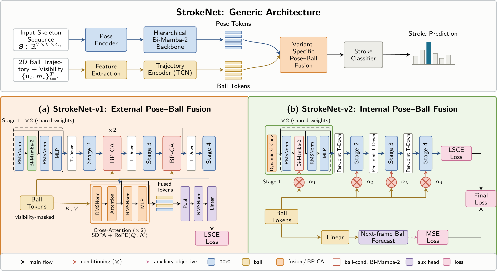
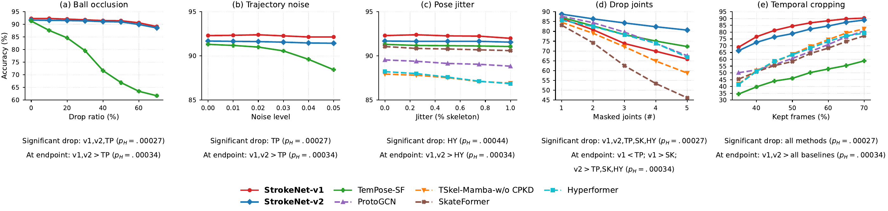

# StrokeNet: Accepted in WACV 2027

Structured State Space Duality for Pose-based Stroke Recognition in Racket Sports.

[Architecture](#architecture) · [Results](#results) · [Installation](#installation) · [Training](#training) · [Evaluation](#evaluation) · [Citation](#citation)

**Fine-Tennis10**
You can download the datasets used in this project directly from Hugging Face:
https://huggingface.co/datasets/madou-ai/Fine-Tennis10
https://huggingface.co/datasets/madou-ai/Fine-Tennis10-RGB

## Overview

StrokeNet studies how an observed ball trajectory complements skeletal motion for stroke recognition. Both variants encode trajectory descriptors with visibility and use a hierarchical bidirectional Mamba-2 backbone.

- **StrokeNet-v1** introduces external pose–ball fusion through anatomical body-part cross-attention and late fusion.
- **StrokeNet-v2** combines dynamic graph-based spatial refinement with per-joint temporal state-space processing. Ball features condition the SSD input projection, output projection and discretization step; a next-frame ball prediction objective provides auxiliary supervision.

Fine-Tennis10 is the primary tennis benchmark. BadmintonDB is an external 18-class benchmark with a shared two-player encoder and a player-interaction head.

## Architecture



[Vector PDF](docs/figures/strokenet_family_architecture.pdf)

## Results

Results are **mean ± standard deviation over multiple seeds** (three seeds for StrokeNet), in percent. Standard deviation measures run-to-run variation. Fine-Tennis10 pose-based results use **score-level ensembles of separately trained joint and bone streams**.

### Fine-Tennis10

| Method | Modality | Top-1 | M-Acc | M-F1 | Top-2 |
| --- | --- | --- | --- | --- | --- |
| ResNet3D | R | 63.31 ± 0.20 | 53.81 ± 0.18 | 53.85 ± 0.06 | 85.96 ± 0.15 |
| PoseConv3D | R+P | 85.65 ± 0.25 | 73.60 ± 0.19 | 73.71 ± 0.41 | 94.44 ± 0.29 |
| MS-G3D | P | 89.73 ± 0.10 | 79.99 ± 0.04 | 80.71 ± 0.38 | 95.73 ± 0.17 |
| BlockGCN | P | 90.18 ± 0.26 | 78.65 ± 0.58 | 78.80 ± 0.35 | 95.79 ± 0.08 |
| ProtoGCN | P | 90.94 ± 0.09 | 80.26 ± 0.17 | 80.89 ± 0.09 | 96.34 ± 0.11 |
| TimeSformer | R | 84.66 ± 0.10 | -- | -- | -- |
| Hyperformer | P | 89.46 ± 0.19 | 78.21 ± 0.18 | 78.23 ± 0.23 | 95.85 ± 0.07 |
| TemPose-TF (court-pos-z) | P+B | 91.33 ± 0.42 | 81.23 ± 0.87 | 81.01 ± 0.93 | 96.15 ± 0.02 |
| TemPose-SF | P+B | 91.98 ± 0.26 | 81.59 ± 0.75 | 81.79 ± 0.85 | 96.68 ± 0.05 |
| SkateFormer | P | 91.33 ± 0.20 | 81.17 ± 0.15 | 81.81 ± 0.31 | 96.26 ± 0.22 |
| Simba | P | 88.68 ± 0.22 | 76.87 ± 0.37 | 77.01 ± 0.23 | 95.32 ± 0.18 |
| TSkel-Mamba-w/o CPKD | P | 88.86 ± 0.18 | 79.81 ± 0.44 | 78.55 ± 0.54 | 95.97 ± 0.02 |
| StrokeNet-v1 (Ours) | P+B | 92.35 ± 0.25 | 81.81 ± 0.46 | 82.48 ± 0.40 | 96.45 ± 0.28 |
| StrokeNet-v2 (Ours) | P+B | 92.08 ± 0.11 | 82.58 ± 0.23 | 83.09 ± 0.03 | 96.45 ± 0.18 |

R/P/B: RGB / pose / ball. M-Acc is the mean class recall; M-F1 is the unweighted mean class F1. “court-pos-z” denotes zeroed player court positions.

### BadmintonDB

| Method | SP | PP | Top-1 |
| --- | --- | --- | --- |
| ST-GCN | No | No | 56.02 ± 2.52 |
| BlockGCN | No | No | 57.82 ± 2.21 |
| ProtoGCN | No | No | 56.56 ± 3.74 |
| TemPose-V | No | No | 57.64 ± 1.87 |
| TemPose-PF | No | Yes | 59.86 ± 1.58 |
| TemPose-TF | Yes | Yes | 61.99 ± 1.69 |
| TemPose-SF | Yes | No | 62.04 ± 1.07 |
| TSkel-Mamba-w/o CPKD | No | No | 57.53 ± 3.92* |
| StrokeNet-v1 (Ours) | Yes | No | 63.85 ± 0.58 |
| StrokeNet-v2 (Ours) | Yes | No | 62.91 ± 1.63 |

SP/PP: shuttle position / player court position. * TSkel-Mamba was evaluated by us. The StrokeNet rows use the two-player interaction adaptations, StrokeNet-v1-I and StrokeNet-v2-I.

[Full LaTeX table](docs/results/main_results.tex) · [Machine-readable values](docs/results/main_results.json)

## Robustness



Top-1 accuracy of joint-stream checkpoints under five inference-time perturbations. Footers show only Holm-significant (p_H < .05) match-cluster permutation tests: “Significant drop” compares clean and maximum perturbation, while “At endpoint” compares StrokeNet with baselines. These curves use one corruption seed and are separate from the three-seed ensemble results above.

[Vector PDF](docs/figures/strokenet_robustness.pdf)

## Repository structure

```text
configs/        Fine-Tennis10 joint/bone and BadmintonDB interaction configs
models/         StrokeNet-v1/v2, spatial and temporal layers, interaction heads
feeders/        Skeleton, trajectory and dataset-specific preprocessing
training/       Dataset-specific training and checkpoint evaluation
mamba_ssm/      Mamba runtime with the model's bidirectional/conditioning modules
scripts/        Train, evaluate, ensemble, seed summaries and data validation
evaluation/     Metric definitions and ensemble search tie breaking
tests/          Synthetic loader, metric, loss and CUDA smoke tests
docs/           Data protocol, figures and results
licenses/       Third-party license texts
```

## Installation

Use Linux, Python 3.11, PyTorch 2.4.0 and CUDA 12.1. Training uses FP32. Native Mamba kernels require an NVIDIA GPU and compatible CUDA extensions. Run commands from the repository root.

```bash
conda env create -f environment.yml
conda activate strokenet
python -m pip install torch==2.4.0 torchvision==0.19.0 --index-url https://download.pytorch.org/whl/cu121
python -m pip install -r requirements.txt
python -m pip install causal-conv1d==1.4.0 mamba-ssm==2.2.4 --no-build-isolation
```

The installed Mamba distribution supplies the compiled extensions. The repository's `mamba_ssm/` Python modules must take precedence: the public entry points add the repository root to the import path. Replacing these modules with stock Mamba changes the models.

```bash
python -m unittest discover -s tests -v
```

The test suite reports CUDA tests as skipped when a GPU is unavailable. UMAP is optional for feature visualizations and is not required by the environment. A writable `NUMBA_CACHE_DIR` may be needed if UMAP is already installed in a restricted environment.

## Data preparation

### Fine-Tennis10

**Fine-Tennis10 will be made publicly available upon acceptance of the paper.** No clips, annotations, trajectories or dataset download links are included here. The loader expects H36M-17 skeleton JSON and corresponding ball CSV files; see [the exact data interface](docs/data.md).

### BadmintonDB

Obtain the dataset from [BadmintonDB](https://github.com/kwban/badminton-db). For the derived skeleton benchmark used here, follow the [official BST preparation instructions](https://github.com/Va6lue/BST-Badminton-Stroke-type-Transformer#reproducing-the-results), selecting the uncollated **BadmintonDB_data / dataset_npy (seq_len=72)** resource. Place its train/val/test directories under `data/BadmintonDB/dataset_npy/`.

```bash
python scripts/prepare_badmintondb.py --data-root data/BadmintonDB/dataset_npy --check-counts
```

This validates the existing split and input shapes. StrokeNet's feeder performs temporal sampling, joint/bone construction and trajectory descriptor extraction. It does not require BST's final collated arrays. See [data and benchmark details](docs/data.md).

## Training

Train Fine-Tennis10 joint and bone streams separately:

```bash
python scripts/train.py --config configs/fine_tennis10/v1_joint.yaml --seed 1 --work-dir work_dirs/v1_joint
python scripts/train.py --config configs/fine_tennis10/v1_bone.yaml --seed 1 --work-dir work_dirs/v1_bone
python scripts/train.py --config configs/fine_tennis10/v2_joint.yaml --seed 1 --work-dir work_dirs/v2_joint
python scripts/train.py --config configs/fine_tennis10/v2_bone.yaml --seed 1 --work-dir work_dirs/v2_bone
```

Repeat with `--seed 2` and `--seed 3`, using a distinct work directory for each run. Add `--check-config` to validate arguments and imports without loading data or starting training. Native trainer arguments can follow the wrapper arguments, for example `--device 0`.

### BadmintonDB benchmark

```bash
python scripts/train.py --config configs/badmintondb/v1.yaml --seed 1 --work-dir work_dirs/badmintondb_v1
python scripts/train.py --config configs/badmintondb/v2.yaml --seed 1 --work-dir work_dirs/badmintondb_v2
```

The benchmark contains 6,120 training, 757 validation and 781 test clips. Each clip contains two COCO-17 players and a shuttle trajectory. Nine stroke types are assigned to top or bottom player; flick serves are merged into serves. Joint and bone coordinates are concatenated as input channels in this adaptation. A shared per-player encoder and interaction Transformer preserve player order; court-position inputs are not used.

Training uses the validation split for **Macro-F1 checkpoint selection**, a maximum of 400 epochs and early-stopping patience of 200 epochs. Evaluation switches to the held-out test split. Repeat over three seeds for the reported run-level statistics.

## Evaluation

Fine-Tennis10 checkpoints are selected by **Top-1**, independently for each stream:

```bash
python scripts/evaluate.py --config configs/fine_tennis10/v1_joint.yaml --weights work_dirs/v1_joint/best_top1.pt --work-dir work_dirs/eval_v1_joint
python scripts/evaluate.py --config configs/fine_tennis10/v1_bone.yaml --weights work_dirs/v1_bone/best_top1.pt --work-dir work_dirs/eval_v1_bone
python scripts/evaluate.py --config configs/fine_tennis10/v2_joint.yaml --weights work_dirs/v2_joint/best_top1.pt --work-dir work_dirs/eval_v2_joint
python scripts/evaluate.py --config configs/fine_tennis10/v2_bone.yaml --weights work_dirs/v2_bone/best_top1.pt --work-dir work_dirs/eval_v2_bone
```

Each evaluation exports `epoch1_test_score.pkl`, a mapping from sample names to raw class scores. For each seed, combine the matching joint and bone predictions:

```bash
python scripts/ensemble.py --joint work_dirs/eval_v1_joint/epoch1_test_score.pkl --bone work_dirs/eval_v1_bone/epoch1_test_score.pkl --annotation data/Fine-Tennis10/dataset/test/annotation.txt --search --output work_dirs/ensemble_v1/metrics.json
python scripts/ensemble.py --joint work_dirs/eval_v2_joint/epoch1_test_score.pkl --bone work_dirs/eval_v2_bone/epoch1_test_score.pkl --annotation data/Fine-Tennis10/dataset/test/annotation.txt --search --output work_dirs/ensemble_v2/metrics.json
```

The ensemble procedure searches the joint weight from 0 to 1 in increments of 0.001, combines raw scores as `w * joint + (1 - w) * bone`, and maximizes Top-1. Ties are resolved by Macro-F1, then Top-5, retaining the first weight on a complete tie. Top-2 is reported separately. The search uses the labels supplied by `--annotation`; the commands above use the test annotations. For evaluation with a previously selected weight, replace `--search` with `--joint-weight VALUE`.

BadmintonDB evaluation uses its validation-selected checkpoint:

```bash
python scripts/evaluate.py --config configs/badmintondb/v1.yaml --weights work_dirs/badmintondb_v1/best_macro_f1.pt --work-dir work_dirs/eval_badmintondb_v1
python scripts/evaluate.py --config configs/badmintondb/v2.yaml --weights work_dirs/badmintondb_v2/best_macro_f1.pt --work-dir work_dirs/eval_badmintondb_v2
```

## Reproducibility

The released training configuration is as follows: Fine-Tennis10 uses 300 epochs, batch size 128 and EMA decay 0.999; BadmintonDB uses the interaction configs above. The optimizer is AdamW with weight decay 0.08, gradient clipping at 1.0 and 25-epoch warmup followed by cosine decay. Fine-Tennis10 uses effective-number sampling; BadmintonDB uses the feeder's class-balanced replication.

Metrics in JSON are fractions; multiply by 100 for percentage points. Macro-Accuracy and Macro-F1 include all configured classes, assigning zero to unsupported classes. Compute mean and sample standard deviation (`ddof=1`) over the three independent per-seed results, not over test clips. Checkpoint selection and ensemble-weight selection are distinct operations. After saving one ensemble JSON per seed, summarize them with:

```bash
python scripts/summarize.py work_dirs/ensemble_v1_seed1/metrics.json work_dirs/ensemble_v1_seed2/metrics.json work_dirs/ensemble_v1_seed3/metrics.json
```

No pretrained checkpoint is bundled with this release.

## Acknowledgments

The implementation builds on [Mamba](https://github.com/state-spaces/mamba), graph-based skeleton modeling and the BadmintonDB/BST benchmark resources. See [third-party notices](docs/third_party.md).

## Citation

The paper citation will be added when its official bibliographic metadata is available.
